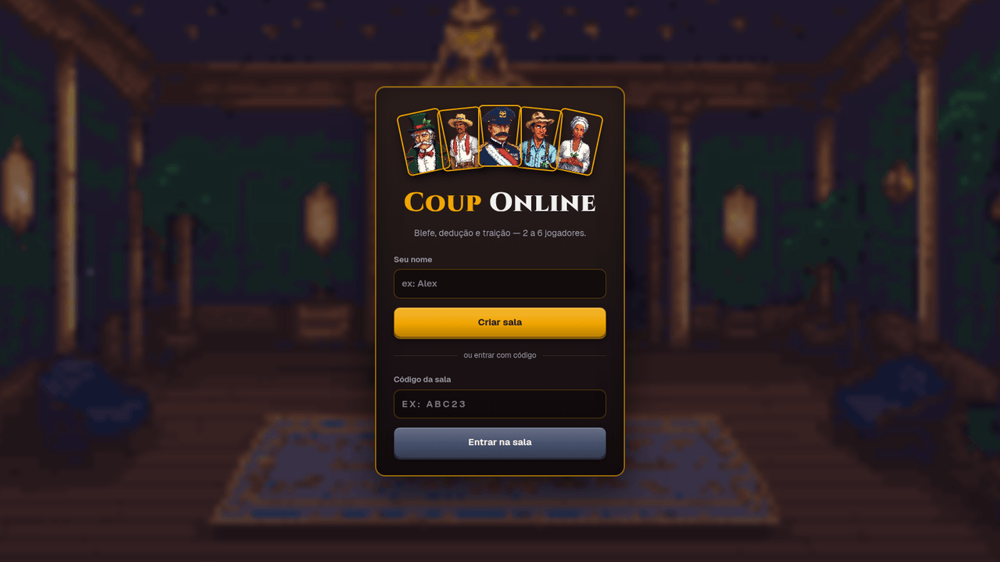
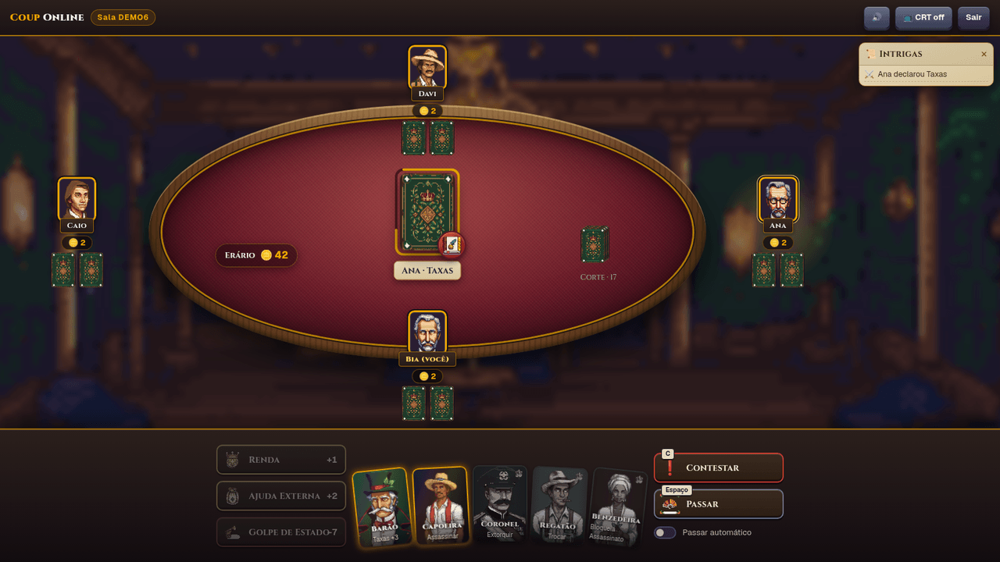
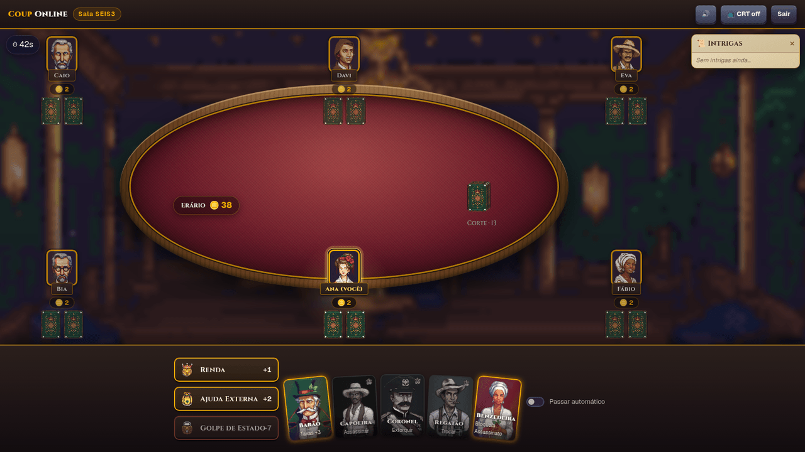
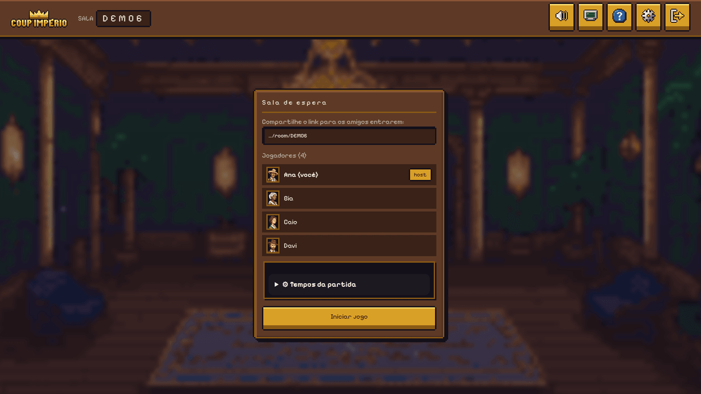
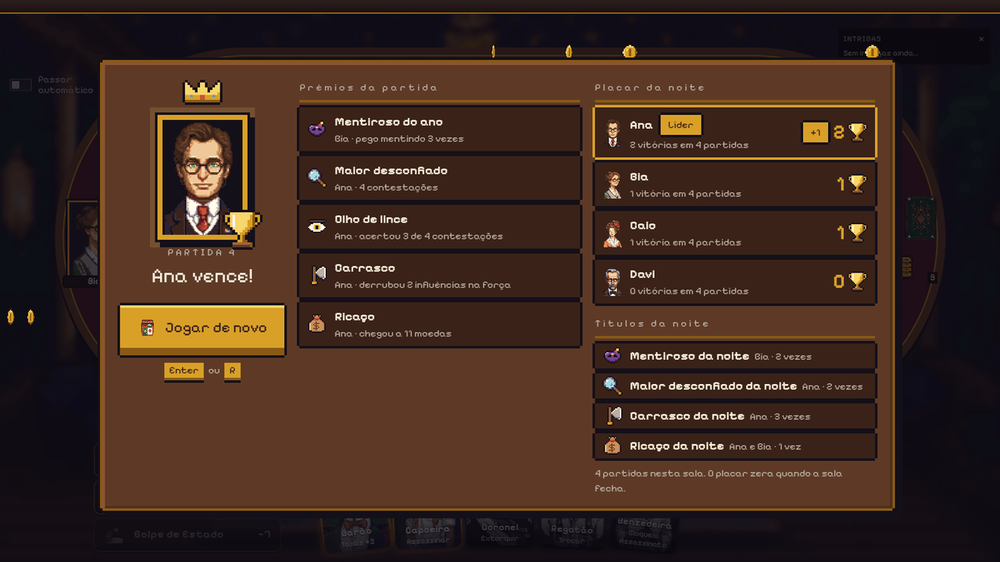
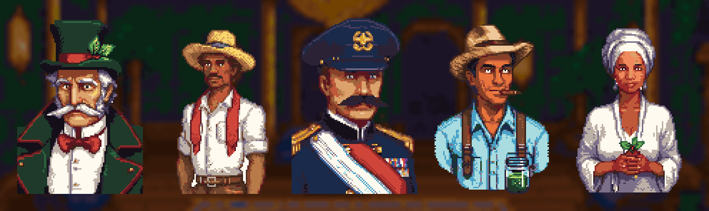
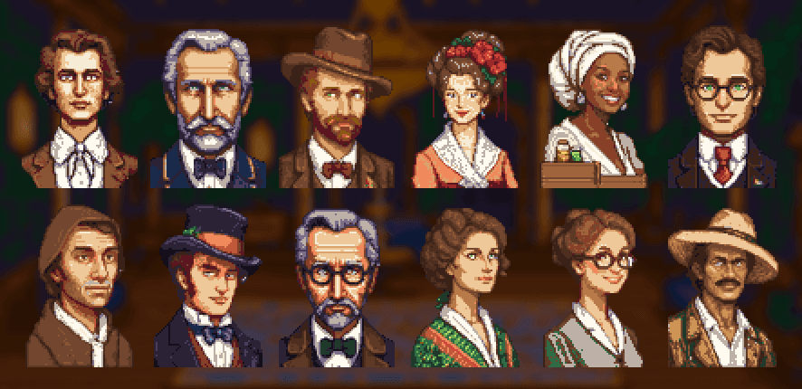

<div align="center">

# 👑 Coup Online

**Blefe, dedução e traição no Brasil Império.**
Um jogo de cartas online para 2 a 6 jogadores — sem cadastro, é só abrir o link e jogar.



`Next.js 16` · `React 19` · `TypeScript` · `Socket.IO` · `Tailwind v4` · pixel art feita por IA

</div>

---

## O que é

**Coup** é um jogo de blefe: cada jogador tem duas cartas de personagem viradas para baixo e
pode **alegar ser quem quiser** para usar o poder daquela carta. Mentir é permitido… até
alguém te **contestar**. Quem perde todas as cartas está fora; o último de pé vence.

Esta é uma versão online **não-oficial**, ambientada no **Brasil Império (1822–1889)**, com
arte pixel art, animações de baralho, efeitos sonoros e partidas em tempo real com os amigos.

> ⚠️ **É um projeto de aprendizado.** Nasceu para explorar como construir software com
> auxílio de IA (planejamento, implementação, testes e arte), usando uma réplica do Coup
> como caso prático. Veja o [aviso legal](#aviso-legal) e a seção
> [Sobre o desenvolvimento assistido por IA](#sobre-o-desenvolvimento-assistido-por-ia).

## Veja o jogo

<table>
<tr>
<td width="50%"><br><sub><b>A jogada acontece na mesa:</b> a carta alegada fica virada no centro, com o tempo restante. Quem pode reagir vê os selos <i>Contestar</i> e <i>Passar</i>.</sub></td>
<td width="50%"><br><sub><b>De 2 a 6 jogadores</b> numa mesa de veludo, cada um com seu retrato de convidado do baile.</sub></td>
</tr>
<tr>
<td width="50%"><br><sub><b>Sala de espera:</b> compartilhe o link, ajuste os tempos da partida e o host inicia.</sub></td>
<td width="50%"><br><sub><b>Fim de partida:</b> prêmios como <i>Mentiroso do ano</i> e <i>Olho de lince</i>, e revanche em um clique.</sub></td>
</tr>
</table>

## Os personagens

As cinco cartas do Coup foram adaptadas para o Brasil Império. As regras são as mesmas do
manual; só o tema muda (os ids internos continuam `duque`, `assassino`, `capitao`,
`embaixador` e `condessa`).



| Personagem | No Coup original | Ação | Bloqueia |
|---|---|---|---|
| **Barão do Café** | Duque | **Taxas:** +3 moedas do Erário | Ajuda Externa |
| **Capoeira** | Assassino | **Assassinar:** paga 3, o alvo perde uma influência | — |
| **Coronel** (da Guarda Nacional) | Capitão | **Extorquir:** toma 2 moedas de um jogador | Extorsão |
| **Regatão** (comerciante fluvial) | Embaixador | **Trocar:** compra 2 cartas da Corte e troca | Extorsão |
| **Benzedeira** | Condessa | — | Assassinato ("corpo fechado") |

As moedas do **Erário** são os réis do Império. Além dos poderes, todos podem jogar **Renda**
(+1), **Ajuda Externa** (+2, bloqueável pelo Barão) ou, com 7 moedas, o **Golpe de Estado**
(o alvo perde uma influência, sem defesa). Com 10 ou mais moedas, o Golpe é obrigatório.

## Como jogar

1. **Na sua vez**, escolha uma ação: use um selo básico (Renda, Ajuda Externa, Golpe) ou
   **clique na carta** do personagem para usar o poder dela (também dá para **arrastar** a
   carta até o oponente-alvo). Você **pode blefar**: as cinco cartas ficam sempre na mão e
   as que você *não* tem aparecem com uma máscara 🎭.
2. **Os outros reagem:** podem **bloquear** (alegando outro personagem), **contestar**
   (apostando que é mentira) ou **passar**.
3. **Contestação:** quem foi contestado revela a carta. Se tinha, o contestador perde uma
   influência; se mentiu, quem perde é o mentiroso.
4. **Vence** o último jogador com influência.

Dicas de ritmo: **`Espaço`** passa, **`C`** contesta, **`B`** bloqueia, e há um interruptor de
**passar automático** para não precisar clicar em jogadas que não te afetam. Se alguém some, o
tempo da vez acaba e o jogo segue sozinho.

As regras completas (timers, "Perigo Duplo do Assassino", casos especiais) estão em
[`game-rules.md`](./game-rules.md).

## Recursos

- 🎭 **Tema Brasil Império** com arte pixel art, paleta fixa de 38 cores e retratos de 12 convidados.
- 🃏 **Mesa viva:** distribuição do baralho, moedas voando entre o Erário e os jogadores,
  carta que vira na contestação (e a mesa treme quando é blefe), inclinação 3D e brilho
  *foil* nas cartas que são suas.
- 🔊 **Áudio sintetizado** no navegador (sem arquivos de som) com botão de mudo.
- ⏱️ **Fluidez:** botão *Passar*, timeouts em todas as fases, relógio controlado pelo servidor,
  **reconexão** sem login (F5 no meio da partida mantém seu lugar e sua mão) e **revanche**.
- 🏆 **Estatísticas e prêmios** ao fim de cada partida.
- 🔒 **Sem trapaça por construção:** o servidor é a única fonte da verdade e o navegador
  **nunca** recebe as cartas dos outros — nem escondidas no JSON.
- 🧪 **Testado em três níveis:** unitário, integração com servidor real e E2E no Chrome.

## Como rodar

```bash
npm install
npm run dev          # http://localhost:3000
```

Abra `http://localhost:3000`, digite um nome e **crie uma sala**. Mande o link para os amigos
(ou abra uma segunda aba e entre com o código). Com 2+ jogadores, o host inicia.

Para jogar com amigos fora da sua rede, o servidor precisa estar acessível a eles (um host com
suporte a **WebSocket**; hospedagens só de funções serverless, como a Vercel, **não** servem
por causa do Socket.IO). Em produção:

```bash
npm run build
npm start            # NODE_ENV=production, porta via PORT (padrão 3000)
```

### Scripts

| Comando | O que faz |
|---|---|
| `npm run dev` | Servidor de desenvolvimento (Next + Socket.IO via `tsx server.ts`) |
| `npm run build` / `npm start` | Build de produção e servidor de produção |
| `npm run lint` | ESLint |
| `npm test` | Testes unitários e de integração |
| `npm run test:e2e` | Faz o build e roda os testes no Chrome real |
| `npx tsx tools/readme-shots.ts` | Regenera as imagens deste README (precisa de build) |

Páginas de revisão visual (só para desenvolvimento): `/dev/mesa`, `/dev/selos`, `/dev/cartas`
e `/dev/audio`.

## Testes

Tudo é testado em três níveis (política completa em [`CLAUDE.md`](./CLAUDE.md)):

| Nível | O que cobre |
|---|---|
| **Unitário** (`node:test`) | Engine de regras, salas, helpers, derivação de eventos da UI, prêmios, receitas de áudio |
| **Integração** | Servidor Socket.IO real em memória: sala, reconexão, timers, Passar, revanche, contestação pública e o **filtro de cartas por socket** |
| **E2E no navegador** | Chrome headless contra o build de produção; cada aba é um jogador, com **cliques de mouse reais**, F5 no meio da partida, layout de 2 a 6 jogadores, e reprova qualquer `console.error` ou exceção |

Requisito do E2E: Google Chrome (`CHROME=/caminho/do/chrome` se não for `google-chrome-stable`).
Os testes usam portas livres e nunca a 3000.

## Arquitetura

```
app/                      # rotas (menu, sala, páginas /dev) + estilos globais
server.ts                 # sobe HTTP + Next + Socket.IO
src/
  server/                 # socket.ts (eventos, timers, reconexão) e rooms.ts (salas em memória)
  lib/game/               # engine.ts (regras — fonte da verdade), cards.ts, deck.ts, awards.ts
  lib/audio/              # efeitos e trilha sintetizados (Web Audio)
  components/game/        # mesa, cartas, mão, selos, animações, feed de Intrigas
  types/                  # tipos de domínio e de socket
tests/e2e/                # testes no navegador
tools/art/                # pipeline de geração e pós-processamento de pixel art
```

Decisões conscientes: estado **em memória** (reiniciar o servidor perde a partida — e tudo bem
para 2 a 6 amigos), **sem login** (o jogador é um nome + um `playerId` e um token guardados na
sessão do navegador, o que permite reconectar), e lógica de jogo em funções puras testáveis.
Contexto completo em [`AGENTS.md`](./AGENTS.md).

## A arte

Os retratos, versos, cenário e ícones foram **gerados localmente com IA** (Stable Diffusion XL +
LoRA de pixel art, rodando em uma RX 6600 via Vulkan) e depois **pós-processados em script**:
redução por blocos, remoção de fundo e quantização para uma paleta mestra de 38 cores, para tudo
parecer da mesma mão. Cada imagem foi escolhida à mão entre várias sementes. O passo a passo está
em [`tools/art/README.md`](./tools/art/README.md).



*Os 12 convidados do baile, sorteados para cada jogador (o mesmo retrato no lobby e na mesa).*

Antes de qualquer uso além de estudo, confira as licenças dos modelos usados.

## Licença e contribuições

O **código** é open source sob a licença [MIT](./LICENSE): pode usar, copiar e modificar.
Contribuições são bem-vindas (issues e pull requests no
[repositório](https://github.com/AlexandreJr16/coup-online)).

A licença MIT cobre o código. As **imagens** em `public/art` foram geradas com modelos de IA
(famílias OpenRAIL, com restrições de uso próprias, veja [`docs/SPIKE_ARTE.md`](./docs/SPIKE_ARTE.md))
e **não estão cobertas pela MIT**; confira os termos dos modelos antes de reutilizá-las.
Coup é um jogo de terceiros: este é um projeto não oficial de fãs, sem fins lucrativos.

## Documentação do projeto

| Documento | Conteúdo |
|---|---|
| [`game-rules.md`](./game-rules.md) | Regras do jogo, timers e fluxos de estado (a engine é fiel a ele) |
| [`docs/DIRECAO_CRIATIVA.md`](./docs/DIRECAO_CRIATIVA.md) | Universo, personagens, estilo e paleta |
| [`docs/DESIGN_MESA_V2.md`](./docs/DESIGN_MESA_V2.md) | Desenho da mesa v2 (dock, selos, jogada na mesa) |
| [`docs/AUDIO.md`](./docs/AUDIO.md) | Efeitos e trilha |
| [`docs/ROADMAP.md`](./docs/ROADMAP.md) | O que foi feito e o que vem a seguir |
| [`AGENTS.md`](./AGENTS.md) / [`CLAUDE.md`](./CLAUDE.md) | Contexto, regras do projeto e política de testes |

## Status e próximos passos

Versão **v2**: jogo completo e jogável de ponta a ponta. Ainda há cantos não acabados:

- Escolha do retrato no lobby e balões de fala dos personagens.
- Ícones de *Contestar* e *Trocar* em pixel art (hoje há emoji no lugar).
- Os sons foram medidos por teste automático, mas ainda não ouvidos e ajustados por ouvido humano.
- Indicador de "ausente" no assento, limite de taxa de eventos e versão para celular.

Mais em [`docs/ROADMAP.md`](./docs/ROADMAP.md).

## Sobre o desenvolvimento assistido por IA

O código foi construído em conjunto com um agente de IA (**Claude Code**), num fluxo deliberado:

1. **Plano antes de implementar:** cada entrega começa por um plano aprovado.
2. **Implementação incremental** com commits por entrega (histórico legível).
3. **Verificação a cada passo:** `tsc`, `eslint`, testes nos três níveis e, na interface, testes
   que abrem o jogo de verdade no navegador.
4. **Limites claros de escopo** em [`AGENTS.md`](./AGENTS.md): o servidor é a fonte da verdade, a
   UI não toca na engine e nada de dependência nova sem avisar.

## Aviso legal

**Coup** é um jogo de Rikki Tahta (La Mame Games; Funbox Jogos no Brasil). Este repositório é um
**fan project sem afiliação oficial**, com tema e nomes adaptados, feito para estudo e **sem fins
comerciais**. Se você curtiu o jogo, compre a versão oficial. 🙂
