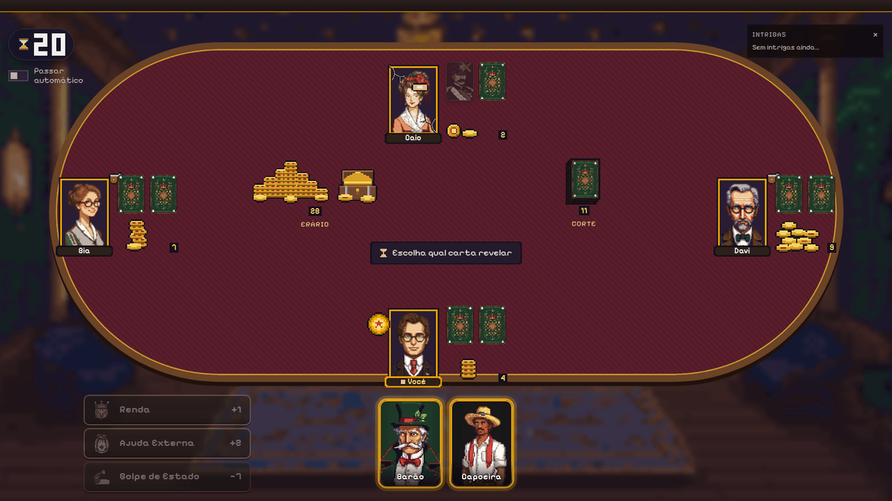
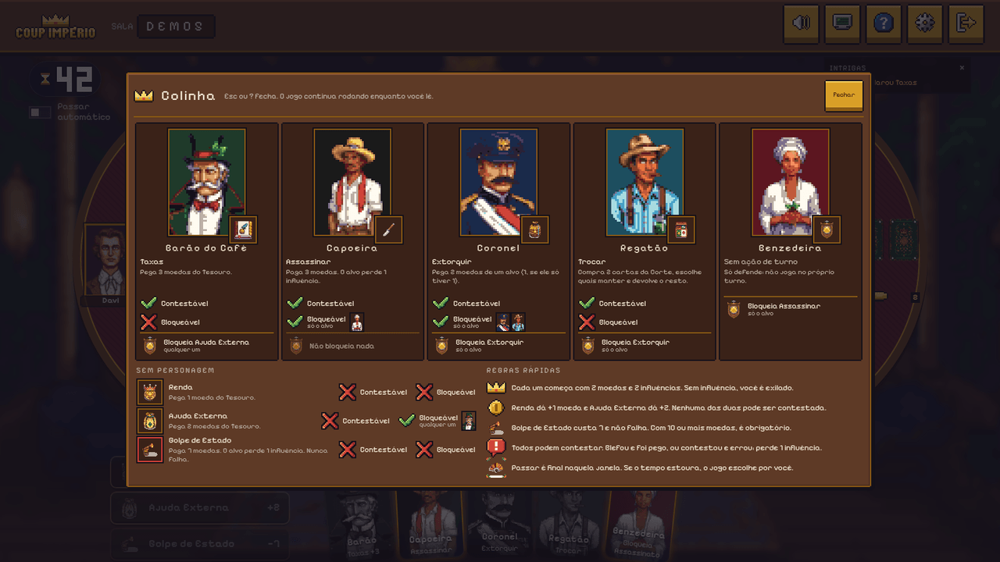

<div align="center">

# 👑 Coup Império

**Blefe, dedução e traição no Brasil Império.**
Jogo de cartas online para 2 a 6 jogadores, em pixel art. Sem cadastro: abra o link, escolha um
nome e chame os amigos.

### [▶ Jogar agora](https://coup-online-9m54.onrender.com)


`v3.1` · `Next.js 16` · `React 19` · `TypeScript` · `Socket.IO` · `542 testes + 79 cenários no navegador`

[Como jogar](#como-jogar) · [O que tem no jogo](#o-que-tem-no-jogo) · [Versões](#versões) · [Como foi feito](#como-foi-feito) · [Rodar localmente](#rodar-localmente)

</div>

---

## O que é

**Coup** é um jogo de blefe. Cada jogador tem duas cartas de personagem viradas para baixo e
pode **alegar ser quem quiser** para usar o poder daquela carta. Mentir é permitido… até
alguém te **contestar**. Quem perde as duas cartas é exilado; o último de pé vence.

Esta é uma versão online **não oficial**, ambientada no **Brasil Império (1822–1889)**: os
personagens viraram Barão do Café, Capoeira, Coronel, Regatão e Benzedeira, a mesa é de veludo
num salão de baile e as moedas são os réis do Erário.

> ⚠️ **É um projeto de aprendizado.** Nasceu para explorar como construir software com
> auxílio de IA (planejamento, implementação, testes e arte), usando uma réplica do Coup
> como caso prático. Veja o [aviso legal](#aviso-legal) e [como foi feito](#como-foi-feito).

## Veja o jogo

<table>
<tr>
<td width="50%"><br><sub><b>De 2 a 6 jogadores.</b> Cada um com seu retrato de convidado do baile, as cartas viradas e a pilha de fichas. O Erário fica à esquerda, a Corte (o baralho) à direita e a legenda no centro diz o que a mesa espera.</sub></td>
<td width="50%"><br><sub><b>Perdeu a contestação?</b> Você escolhe qual carta entregar. A carta perdida fica à mostra no assento e a moldura do retrato racha (veja a do Caio).</sub></td>
</tr>
<tr>
<td width="50%"><br><sub><b>Fim de partida:</b> prêmios como <i>Mentiroso do ano</i> e <i>Olho de lince</i>, placar e títulos da noite, e revanche com <code>Enter</code>.</sub></td>
<td width="50%"><br><sub><b>Colinha</b> (<code>?</code>): o que cada personagem faz, o que é contestável e bloqueável e as regras rápidas, por cima da mesa e sem pausar o jogo.</sub></td>
</tr>
<tr>
<td width="50%"><br><sub><b>Sala de espera:</b> mande o link, ajuste os tempos da partida e o host inicia. Quem chega com o jogo rolando assiste e entra na próxima.</sub></td>
<td width="50%"><br><sub><b>Menu:</b> nome, criar sala ou entrar com o código. A colinha e a Aparência já estão na porta.</sub></td>
</tr>
</table>

## Os personagens

As cinco cartas do Coup foram adaptadas para o Brasil Império. As regras são as mesmas do
manual; só o tema muda (os ids internos continuam `duque`, `assassino`, `capitao`,
`embaixador` e `condessa`).


| Personagem | No Coup original | Ação | Bloqueia |
|---|---|---|---|
| **Barão do Café** | Duque | **Taxas:** +3 moedas do Erário | Ajuda Externa |
| **Capoeira** | Assassino | **Assassinar:** paga 3, o alvo perde uma influência | — |
| **Coronel** (da Guarda Nacional) | Capitão | **Extorquir:** toma 2 moedas de um jogador | Extorsão |
| **Regatão** (comerciante fluvial) | Embaixador | **Trocar:** compra 2 cartas da Corte e troca | Extorsão |
| **Benzedeira** | Condessa | — | Assassinato ("corpo fechado") |

Além dos poderes, todos podem jogar **Renda** (+1), **Ajuda Externa** (+2, bloqueável pelo
Barão) ou, com 7 moedas, o **Golpe de Estado** (o alvo perde uma influência, sem defesa). Com
10 ou mais moedas, o Golpe é obrigatório.

## Como jogar

1. **Na sua vez**, use uma ação básica (à esquerda) ou **clique na carta** do personagem para
   usar o poder dela; também dá para **arrastar** a carta até o alvo. Você **pode blefar**: as
   cinco cartas ficam sempre na mão, e as que você *não* tem aparecem apagadas, com uma máscara 🎭.
2. **Os outros reagem:** podem **bloquear** (alegando outro personagem), **contestar**
   (apostando que é mentira) ou **passar**. Um balão sobre o seu assento mostra a todos o que
   você declarou.
3. **Contestação:** quem foi contestado revela a carta. Se tinha, o contestador perde uma
   influência; se mentiu, quem perde é o mentiroso.
4. **Vence** o último jogador com influência.

| Tecla | Faz |
|---|---|
| `Espaço` | Passar |
| `C` / `B` | Contestar / Bloquear |
| `?` | Abre e fecha a colinha (`Esc` também fecha) |
| `Enter` ou `R` | Revanche no fim da partida |

Há um interruptor de **passar automático** para jogadas que não te afetam. Se o tempo estoura,
o jogo escolhe por você (com aviso nos 5 últimos segundos), então ninguém trava a mesa.

As regras completas (timers, "Perigo Duplo do Assassino", casos especiais) estão em
[`game-rules.md`](./game-rules.md).

## O que tem no jogo

**A mesa diz o que está acontecendo sem banner de texto**
- O que foi declarado aparece num **balão sobre o assento** de quem jogou; uma marca mostra de
  quem a mesa está esperando e uma **legenda curta no centro** resume a vez.
- **Coisas em vez de números:** moedas são **pilhas de fichas em pixel art** (de 1 a 10, com
  variantes sorteadas a cada partida e o número exato ao passar o mouse), o Erário é um baú, a
  Corte é um monte de cartas e o relógio é uma ampulheta com dígitos pixel.
- Ao mirar uma ação paga, a parte da sua pilha que vai embora fica **fantasma**; com 10+ moedas,
  o Golpe obrigatório avisa.
- O retrato sente o jogo: **a moldura racha** a cada influência perdida.
- A mesa é um palco de tamanho fixo que **escala com a tela**, verificado de 1280x720 a
  2560x1440 com 2, 4 e 6 jogadores.
- Distribuição do baralho, moedas voando entre o Erário e os jogadores, carta que vira na
  contestação (e a mesa treme quando é blefe), inclinação 3D e brilho *foil* nas cartas que são suas.
- O **histórico de Intrigas** registra cada jogada.

**Ritmo sem travas**
- Passar, passar automático e tempo em todas as fases, com o relógio controlado pelo servidor.
- **Reconexão sem login:** F5 no meio da partida mantém seu lugar e sua mão.
- **Espectador:** quem entra com a partida em andamento assiste e joga a próxima.

**Mais uma partida**
- Prêmios ao fim de cada partida (*Mentiroso do ano*, *Maior desconfiado*, *Olho de lince*,
  *Carrasco*, *Ricaço*).
- **Placar da noite** com vitórias e títulos acumulados enquanto a sala estiver aberta, e
  revanche em um toque.

**Do seu jeito**
- **Aparência:** 4 fontes pixel (Pixelify Sans, Silkscreen, VT323, Press Start 2P) e 2 estilos
  (madeira e latão, pergaminho e tinta), salvos no navegador. Outros formatos para a barra de
  baixo estão a caminho.
- **Áudio sintetizado** no navegador (sem arquivos de som), com botão de mudo.

**Sem trapaça por construção**
- O servidor é a única fonte da verdade e o navegador **nunca** recebe as cartas dos outros,
  nem escondidas no JSON. As animações também não podem entregar quem blefou (veja
  [como foi feito](#nenhuma-animação-pode-entregar-o-blefe)).

## Versões

| Versão | O que trouxe |
|---|---|
| `v1` | O jogo completo: regras no servidor, salas por link, interface simples em CSS |
| `v2` | **Brasil Império:** personagens, verso e cenário em pixel art, áudio, fluidez (passar, tempos, reconexão, revanche), mesa com selos, arrastar e atalhos, prêmios |
| `v3.0` | **Uma linguagem visual só:** kit de UI em pixel art, logo, menu e sala novos, colinha, espectador, aviso dos 5 s, Aparência e placar da noite |
| **`v3.1`** | **Mesa nova:** balão da jogada, legenda, fichas, Erário com baú, moldura que racha, ampulheta, escala com a tela e vitória com placar e títulos |
| `v3.2` (próxima) | **Vida e blefe:** duelo da contestação com suspense, exílio de barco, reações de dano no retrato e áudio novo |

Ainda faltam: escolher o próprio retrato no lobby, outros formatos de barra de baixo, limite de
taxa de eventos e versão para celular.

## Como foi feito

O código foi construído em conjunto com um agente de IA (**Claude Code**). O interessante não é
"a IA escreveu", e sim as regras que tornaram isso confiável:

### Servidor como única fonte da verdade
Toda regra (jogada válida, contestação, bloqueio, eliminação) roda no servidor, numa engine de
funções puras (`src/lib/game/engine.ts`). Cada partida é uma sala do Socket.IO e o servidor monta
uma visão por jogador: suas cartas, as dos outros só como verso. Estado em memória, sem banco:
reiniciar o servidor perde a partida, e para 2 a 6 amigos tudo bem.

### Nenhuma animação pode entregar o blefe
Num jogo de blefe, a mesa precisa se comportar igual para quem fala a verdade e para quem mente
até o instante da revelação. A interface da mesa e o motor de cenas recebem só uma **projeção
pública** da partida (`PublicView`), e um teste de propriedade (`assertNoLeak`) roda cada função
de UI contra todas as variações das cartas escondidas e exige saída idêntica. A legenda, o balão,
a marca de espera, as fichas e o baralho da mesa nova passam por ele.

### Testes em três níveis

| Nível | O que cobre |
|---|---|
| **Unitário** (`node:test`) | Engine de regras, salas, placar e prêmios, derivação de eventos da UI, fichas, escala, receitas de áudio, geradores de arte |
| **Integração** | Servidor Socket.IO real em memória: sala, reconexão, timers, passar, revanche, espectador, contestação pública e o **filtro de cartas por socket** |
| **E2E no navegador** | Chrome headless contra o build de produção; cada aba é um jogador, com **cliques de mouse reais**, F5 no meio da partida, 2 a 6 jogadores, e reprova qualquer `console.error` ou exceção |

Todo bug corrigido ganha um teste de regressão. Política completa em [`CLAUDE.md`](./CLAUDE.md).

### Revisão visual automatizada
Tipos e testes não enxergam texto cortado nem peça em cima de peça. O
[`tools/visual/capturas.ts`](./tools/visual/capturas.ts) sobe o build de produção, abre a mesa em
7 fases do jogo, com 2, 4 e 6 jogadores, em 3 resoluções e nas 4 fontes, salva os prints, e uma
sonda acusa sobreposição, peça fora da tela e texto estourado. Ajuste visual só é dado como pronto
depois de passar por ela e por um olho humano.

### A arte
Os retratos, versos e o cenário foram **gerados localmente com IA** (Stable Diffusion XL + LoRA
de pixel art, numa RX 6600 via Vulkan) e **pós-processados em script**: redução por blocos,
remoção de fundo e quantização para uma paleta mestra de 38 cores. Cada imagem foi escolhida à
mão entre várias sementes. As peças pequenas (fichas, ícones, logo, dígitos do relógio, efeitos)
são **desenhadas por código** em TypeScript, pixel a pixel, na mesma paleta, e um teste reprova
qualquer PNG gerado com cor fora dela. Passo a passo em [`tools/art/README.md`](./tools/art/README.md).


*Os 12 convidados do baile, sorteados para cada jogador (o mesmo retrato no lobby e na mesa).*

### Planejamento com agentes
A v3 foi planejada como uma árvore de **30 planos e 158 subplanos** em [`docs/plano`](./docs/plano),
cada um com critério de pronto, dependências e onda de execução (o `npm run plano:check` confere
a consistência). A execução usa papéis de agente definidos em [`.claude/agents`](./.claude/agents):
arquiteto, revisor de plano, escritor de testes (os testes vêm antes do código), implementador,
verificador mecânico, revisor de código, **auditor de vazamento** (tenta provar que algo revela
uma carta) e artista procedural. A cerimônia é proporcional ao risco: revisão completa onde dá
para vazar informação ou quebrar regra, e o resto direto com testes. Decisões criativas e
irreversíveis (mockups, merge, tag) passam por aprovação humana.

### Medindo o "mais uma partida"
O servidor escreve uma linha JSON por início e fim de partida e por pedido de revanche, sem banco
nem arquivo. Dá para medir quantas revanches cada sala pede direto do log.

## Rodar localmente

```bash
npm install
npm run dev          # http://localhost:3000
```

Abra `http://localhost:3000`, digite um nome e **crie uma sala**. Mande o link para os amigos
(ou abra uma segunda aba e entre com o código). Com 2+ jogadores, o host inicia.

Para jogar com amigos fora da sua rede, o servidor precisa estar acessível a eles (um host com
suporte a **WebSocket**; hospedagens só de funções serverless, como a Vercel, **não** servem
por causa do Socket.IO). Em produção:

```bash
npm run build
npm start            # NODE_ENV=production, porta via PORT (padrão 3000)
```

| Comando | O que faz |
|---|---|
| `npm run dev` | Servidor de desenvolvimento (Next + Socket.IO via `tsx server.ts`) |
| `npm run build` / `npm start` | Build e servidor de produção |
| `npm test` | Testes unitários e de integração |
| `npm run check` | `npm test` + `tsc` + `eslint` |
| `npm run test:e2e` | Faz o build e roda os testes no Chrome real |
| `npx tsx tools/readme-shots.ts` | Regenera as imagens deste README (precisa de build) |
| `npx tsx tools/visual/capturas.ts <pasta>` | Capturas da mesa com a sonda de layout (precisa de build) |

Requisito do E2E e das capturas: Google Chrome (`CHROME=/caminho/do/chrome` se não for
`google-chrome-stable`). Os testes usam portas livres e nunca a 3000.

Páginas de revisão visual (só para desenvolvimento): `/dev/mesa` (com `?fase=` e `?n=`),
`/dev/kit`, `/dev/colinha`, `/dev/selos`, `/dev/cartas` e `/dev/audio`.

### Arquitetura

```
app/                      # rotas (menu, sala, páginas /dev) + estilos globais
server.ts                 # sobe HTTP + Next + Socket.IO
src/
  server/                 # socket.ts (eventos, timers, reconexão), rooms.ts (salas), metrics.ts (log)
  lib/game/               # engine.ts (regras, fonte da verdade), baralho, prêmios, placar da noite
  lib/audio/              # efeitos e trilha sintetizados (Web Audio)
  components/game/        # mesa, assentos, cartas, fichas, dock, colinha, vitória, Intrigas
  components/game/fx/     # motor de cenas e teste de vazamento (PublicView, assertNoLeak)
  components/ui/          # kit de UI pixel (painéis, botões, ícones, Aparência)
  types/                  # tipos de domínio e de socket
tests/e2e/                # testes no navegador (Chrome via DevTools Protocol)
tools/art/                # pixel art: pós-processamento da IA e geradores por código
tools/visual/             # capturas e sonda de layout
docs/plano/               # plano mestre, protocolo, decisões e registro
```

Sem login (o jogador é um nome + um `playerId` e um token guardados na sessão do navegador, o que
permite reconectar) e sem camadas formais: lógica de jogo em `lib/`, transporte em `server/`, UI
em `components/`. Contexto completo em [`AGENTS.md`](./AGENTS.md).

## Documentação do projeto

| Documento | Conteúdo |
|---|---|
| [`game-rules.md`](./game-rules.md) | Regras do jogo, timers e fluxos de estado (a engine é fiel a ele) |
| [`docs/DIRECAO_CRIATIVA.md`](./docs/DIRECAO_CRIATIVA.md) | Universo, personagens, estilo e paleta |
| [`docs/PLANO_V3.md`](./docs/PLANO_V3.md) | Diagnóstico e princípios da v3 (uma linguagem visual, hierarquia da mesa, retenção) |
| [`docs/VIDA_E_BLEFE.md`](./docs/VIDA_E_BLEFE.md) | Animações e efeitos da v3.2 (dano, contestação, exílio) |
| [`docs/plano/00-MESTRE.md`](./docs/plano/00-MESTRE.md) | Plano mestre por subplanos, com o que já foi feito |
| [`docs/AUDIO.md`](./docs/AUDIO.md) | Efeitos e trilha |
| [`docs/DESIGN_MESA_V2.md`](./docs/DESIGN_MESA_V2.md) / [`docs/ROADMAP.md`](./docs/ROADMAP.md) | Desenho da mesa e roadmap da v2 (histórico) |
| [`AGENTS.md`](./AGENTS.md) / [`CLAUDE.md`](./CLAUDE.md) | Contexto, regras do projeto e política de testes |

## Licença e contribuições

O **código** é open source sob a licença [MIT](./LICENSE): pode usar, copiar e modificar.
Contribuições são bem-vindas (issues e pull requests no
[repositório](https://github.com/AlexandreJr16/coup-online)).

A licença MIT cobre o código. As **imagens** em `public/art` foram geradas com modelos de IA
(famílias OpenRAIL, com restrições de uso próprias, veja [`docs/SPIKE_ARTE.md`](./docs/SPIKE_ARTE.md))
e **não estão cobertas pela MIT**; confira os termos dos modelos antes de reutilizá-las.
Coup é um jogo de terceiros: este é um projeto não oficial de fãs, sem fins lucrativos.

## Aviso legal

**Coup** é um jogo de Rikki Tahta (La Mame Games; Funbox Jogos no Brasil). Este repositório é um
**fan project sem afiliação oficial**, com tema e nomes adaptados, feito para estudo e **sem fins
comerciais**. Se você curtiu o jogo, compre a versão oficial. 🙂
